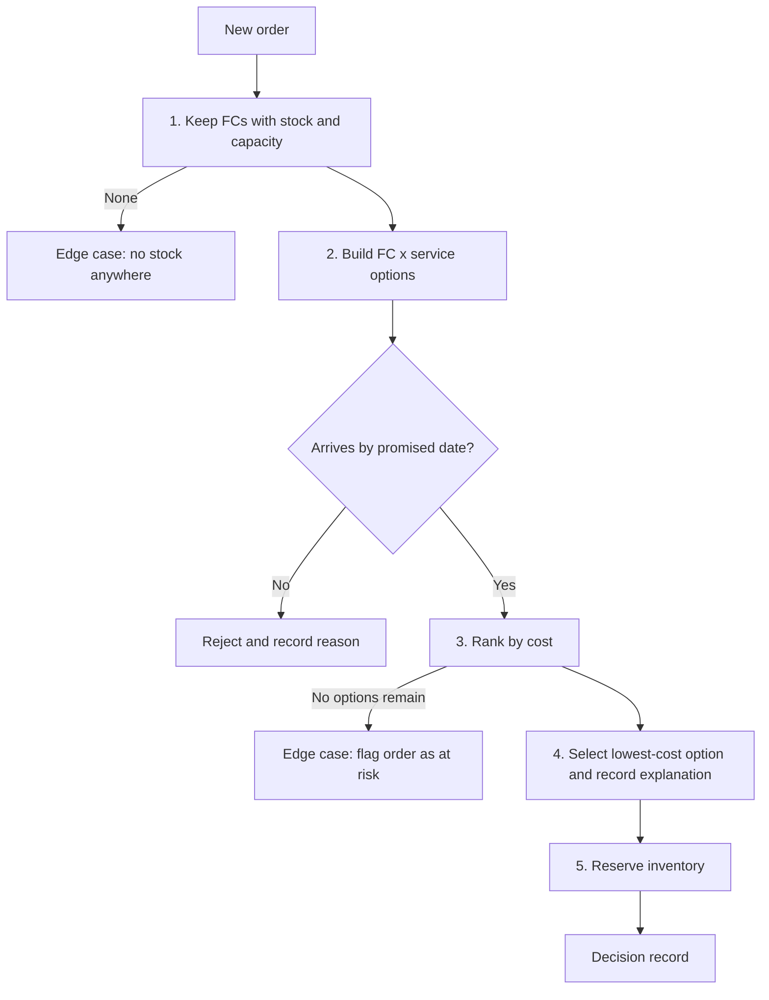

# Sourcing-Engine-Prototype
Case Study

1.0 OVERVIEW
ShipBob supports thousands of ecommerce brands through a network of 60+ fulfillment centers across the US, Canada, the UK, the EU, and Australia, processing roughly 100 million orders annually. The value of that network depends on the sourcing decision made for each order, and that decision is getting harder: 58.65% of brands already use more than one fulfillment center, and 43.99% plan to add more in 2026.

1.1 PROBLEM STATEMENT 
When an order is placed, the sourcing decision determines whether the shopper receives it on the promised date and what the merchant pays to ship it.
Fulfillment commitments have traditionally been expressed as an SLA, a fixed commitment such as shipping within a set number of days. An SLA says little about when an order arrives, because arrival also depends on which fulfillment center ships it and which service it uses. This design moves from SLA-based commitments toward an estimated date of delivery (EDD), calculated for each fulfillment center and service option and compared against the date promised to the shopper.
With multiple fulfillment centers, an order can be assigned to one that cannot meet the promised date, or to one that meets it at a higher cost than necessary. Merchants have little visibility into why a fulfillment center was chosen or what the alternative would have cost.

1.2 CUSTOMER
Primary customer: Merchants (the brands ShipBob fulfills for). Merchants make the delivery promise to their shoppers, so they depend on the sourcing engine to make that promise achievable and to show what it costs. Reliable delivery dates at a controlled shipping cost build merchant trust in ShipBob.
Secondary customer: Supply chain systems and operations teams. Downstream systems execute the sourcing decision, and operations teams act on orders the engine flags as at risk, which requires enough lead time to resolve them before the promised date.
End customer: Shoppers who are given a delivery date at checkout and expect to receive their order on it.

1.3 GLOSSARY 
| **At-Risk Order** | An order for which no FC and service can arrive by the promised date. The engine ships the earliest option, flags the order, and records a revised EDD. |
| **Available Inventory** | Units on hand minus units already reserved. |
| **Baseline A** | The current rule: ship from the closest FC with stock, using Ground. |
| **Baseline B** | The fastest-service rule: always ship the fastest service from the FC that can arrive soonest. |
| **Capacity-Based Routing** | Skip an FC that has reached its daily order limit. |
| **Cost Cap** | The most a merchant will spend on shipping one order. Options above it are removed before ranking, even if they are the only way to meet the promise. |
| **Cost per On-Time Delivery** | Total shipping cost divided by the number of orders delivered on time. |
| **Cutoff Time** | The latest time an order can be handed off for an FC and service to ship that day. Later orders ship the next day, which adds a day to the EDD. The handling buffer is the minimum time before the cutoff needed to pick and pack. |
| **Decision Record** | The explanation saved for each decision: the chosen option, each rejected option and its reason, the cost of alternatives, and the promise premium. |
| **EDD** | The estimated date a package will arrive, calculated from the ship date and transit time. The engine compares each option's EDD to the promised delivery date. |
| **FC** | Fulfillment center. |
| **In-Region Fulfillment** | An order fulfilled from an FC in the same region as the shopper. |
| **On-Time Delivery Rate** | Share of orders delivered on or before the promised date. |
| **Promised Delivery Date** | The delivery date the merchant shows the shopper at checkout. The engine's primary objective is to meet it. |
| **Promise Premium** | The chosen option's cost minus the cheapest option overall, including late ones. |
| **Rate Card** | The cost and transit days for each service, by region distance. |
| **Region** | West, Central, or East. Distance between regions sets the cost and time multiplier: 1x in the same region, 2x one region away, 3x two regions away. |
| **Re-shop** | Running the decision again for an order after its assigned FC cannot fill it. |
| **Service Level** | Ground, Air, or Express, each with its own cost and transit time on the rate card. |
| **Ship-Together Constraint** | Items must ship in the same package or from the same node. |
| **Single-Node Fulfillment** | The whole order ships from one location. |
| **SLA** | A fixed service commitment, such as shipping within a set number of days. This design moves from SLA-based commitments toward EDD-based decisions. |
| **Sourcing / Order Routing** | The decision of which FC and which shipping service fulfill an order. |
| **Split Shipment** | One order fulfilled from more than one location. |


1.4 GOALS (SCOPE)
- Primary: Meet the promised delivery date, measured by on-time delivery rate.
- Secondary: Within that constraint, select the lowest-cost option.
- Show the cost of each decision, including the cheapest feasible alternative, so merchants can see the tradeoff.
- Make every decision explainable, including why other FCs were rejected.
- Handle hard cases: an FC out of stock, and two orders competing for the last unit.
- Work across merchants of different sizes, validated by sample data with varied order volumes and FC footprints.
- (Proposed) Flag orders that no FC can deliver on time, early enough for the supply chain team to act.

1.5 NON-GOALS (OUT OF SCOPE)
- Split shipments will be excluded.
- Live carrier rates will not be looked up
- Inventory transfers between FC will not be used.
- No international shipping

2.0 CURRENT PROBLEM
2.1 Current-State Example

Network: Facilities in Phoenix (West), Dallas (Central), and Atlanta (East), with equal capacity and equal starting inventory.
Rate card: Base rates apply within a region: Ground $5 / 3 days, Air $10 / 2 days, Express $15 / 1 day. Cost and transit time double one region away and triple two regions away. Dallas, in the middle, never exceeds 2x.
Current routing rule (assumed): Ship from the closest FC with stock, using the merchant's default service (Ground).
Order: A shopper in Georgia (East) places an order on Oct 30. The merchant promises delivery by Nov 2.
Trigger: Atlanta sold its last unit of the item to an earlier order.
What the current rule does: The next closest FC with stock is Dallas, which ships by Ground for $10, 6 days. The order arrives Nov 5, which is 3 days late.
What a better decision would have been: Ship from Dallas by Express for $30, 2 days. The order arrives Nov 1 and meets the promise. Air ($20, 4 days) would still arrive Nov 3, one day late. Phoenix Express also meets the date (Nov 2) but costs $45.
Result: Today the merchant misses the promised date and has no visibility into the alternatives. Protecting the promise costs $20 more than the late option ($30 vs. $10).

2.2 Business Value

The value of the engine follows the goals in section 1.4, in priority order. Each point is shown using the order in 2.1.

| Priority | Value driver | Today (2.1) | With the sourcing engine |
|---|---|---|---|
| 1 | Promise kept | The order ships from Dallas by Ground and arrives Nov 5, 3 days after the Nov 2 promise. | Of the six options with stock (two FCs, three services each), only Dallas Express and Phoenix Express meet Nov 2. The engine rejects the other four and ships on one of the two that do. |
| 2 | Cost control | Only one option is considered, so cost is never compared. | Both options that meet the date are compared. Dallas Express costs $30 and Phoenix Express costs $45, so the engine chooses Dallas Express and spends $15 less. |
| 3 | Decision visibility | The merchant sees the outcome but not the alternatives. | The merchant sees the chosen option, each rejected option with the reason (for example, Dallas Air arrives Nov 3, one day late), and the cost of each. This shows that protecting the promise costs $20 more than the late option ($30 vs. $10). |
| 4 | Earlier intervention | The merchant and operations learn about the problem when the package is late. | If the promise had been Oct 31, no option could meet it, since the fastest possible arrival is Nov 1. The engine flags the order at the time it is placed, so operations can act before the date is missed. |

Summary: In this one order, the engine turns a late delivery with no visibility into an on-time delivery at the lowest feasible cost, with the tradeoff shown to the merchant.

3.0 PROPOSED SOLUTION
3.1 | Goal (from 1.4) | Capability | Where it happens (Decision Flow step) |
|---|---|---|
| Meet the promised date | Reject any FC and service that cannot arrive by the promised date | Step 2 |
| Lowest cost within that constraint | Rank the remaining options by cost | Step 3 |
| Show the cost of each decision | Record the cheapest feasible alternative and the cost difference | Step 4 |
| Explainable decisions | Record why each rejected option was rejected | Step 4 |
| Handle hard cases | Out of stock, competing orders, no feasible option | 

3.2 Decision Flow
**Inputs per order:** destination region, item and quantity, order date, promised delivery date.
**Reference data:** inventory by FC, rate card (cost and transit days by service and region distance), FC capacity.

### Steps

| Step | Rule | If it fails |
|---|---|---|
| **1. Check eligibility** | Keep only FCs with enough stock for the item (net of units already reserved) and capacity remaining. | No eligible FC: see Edge Cases (no stock anywhere). |
| **2. Build and filter options** | For each eligible FC and each service (Ground, Air, Express), calculate cost and arrival date (order date + transit days). Reject any option that arrives after the promised date, and record the reason. | No option meets the date: see Edge Cases (no feasible option, flag the order). |
| **3. Rank by cost** | Sort the remaining options by cost, lowest first. Ties: earlier arrival wins, then the FC closer to the shopper. | None. |
| **4. Select and record** | Choose the top option. Record the chosen option, every rejected option with its reason, and the promise premium: the chosen option's cost minus the cheapest option of any kind, including late ones. | None. |
| **5. Reserve inventory** | Reserve one unit at the chosen FC so the next order sees the updated stock. | Two orders competing for the last unit: see Edge Cases. |

### Flow diagram



### Worked example (the order from 2.1)

Order placed Oct 30, shopper in the East, promised Nov 2.

1. **Eligibility:** Atlanta has no stock and is removed. Dallas and Phoenix remain.
2. **Options:**

| Option | Cost | Arrives | Result |
|---|---|---|---|
| Dallas, Ground | $10 | Nov 5 | Rejected: 3 days late |
| Dallas, Air | $20 | Nov 3 | Rejected: 1 day late |
| **Dallas, Express** | **$30** | **Nov 1** | **Meets date** |
| Phoenix, Ground | $15 | Nov 8 | Rejected: 6 days late |
| Phoenix, Air | $30 | Nov 5 | Rejected: 3 days late |
| Phoenix, Express | $45 | Nov 2 | Meets date |

3. **Rank:** Dallas Express ($30) is below Phoenix Express ($45).
4. **Select and record:** Dallas Express is chosen. Promise premium = $30 − $10 (Dallas Ground, the cheapest option overall) = **$20**.
5. **Reserve:** One unit is reserved at Dallas.

3.3 Edge Cases
| Case | Trigger | Rule | What is recorded |
|---|---|---|---|
| **FC out of stock** | Closest FC has no available units (on hand minus reserved) | Remove the FC and evaluate the remaining FC and service options through the normal flow | FC removed and why |
| **FC cannot fill after assignment** | After assignment, the FC finds the order cannot be filled (for example, damaged items) | Re-run the flow from the current time, excluding that FC. Arrival uses the FC's cutoff time: if the order misses the cutoff, shipping moves to the next day | Original assignment, reason for re-shop, new assignment |
| **Competing orders** | Two orders need the last unit at an FC | Resolve the orders together. Choose the assignment that keeps the most promises, then the lowest total cost, then the earlier order | Both orders' options and why the unit went where it did |
| **No option meets the date** | No FC and service arrives by the promised date | Ship the earliest-arriving option, flag the order as at risk, and record a revised EDD for the merchant and shopper to be notified | Revised EDD and the cost of the fastest option |
| **Merchant cost cap** | Merchant sets a maximum shipping cost per order | Remove any option above the cap before ranking. The cap overrides the promise. If no remaining option meets the date, use the rule above. If nothing is under the cap, flag for merchant review | Options removed by the cap and what meeting the date would have cost |

### Worked examples

**Competing orders.** Atlanta has one unit left. Order A is promised Oct 31, and only Atlanta Express ($15, 1 day) can meet that. Order B is promised Nov 2, and either Atlanta Ground ($5) or Dallas Express ($30, arrives Nov 1) meets it.
- First come, first served with B first: B takes Atlanta, and A misses its promise.
- Rule: A gets Atlanta ($15), and B ships from Dallas Express ($30). Both promises are kept, for $45 total.

**Cost cap.** Using the 2.1 order (promised Nov 2). With a $30 cap, Phoenix Express ($45) is removed, and Dallas Express ($30) is chosen. With a $25 cap, Dallas Express is also removed. Nothing meeting the date remains, so the engine ships the earliest-arriving option under the cap (Dallas Air, $20, arrives Nov 3), flags the order, and records the revised EDD.

**Re-shop near the cutoff.** An order to Georgia is promised Nov 5. At 1:30 PM on Oct 30, Atlanta reports damaged items and the order re-shops to Dallas, whose Ground trailer leaves at 2 PM.
- Makes the trailer: Dallas Ground, $10, arrives Nov 5.
- Misses it: Ground ships Oct 31 and arrives Nov 6, one day late, so the engine picks Dallas Air ($20, 4 days, arrives Nov 4).
- The handling buffer (the minimum time needed before cutoff to pick and pack) decides which case applies.

### Deferred
- **Hot region:** Routing can't fix inventory placed in the wrong region. The engine can expose out-of-region shipments by item and region, as an input to placement. See Future State.
- **Per-client changes:** Keep merchant settings (cost cap, allowed services, FC preferences) separate from the rules, so the engine can vary per client without code changes. See Future State.

3.4 Advanced / Future State
The MVP handles edge cases when they happen. These ideas aim to make them happen less often. None are built or validated in the prototype, and each lists what it would need first.

### 1. Regional demand forecasting and placement guidance
- **Problem it addresses:** Out-of-stock at the closest FC, and hot regions where stock sits far from demand. In the 2.1 example, Atlanta running out turned a $10 late shipment into a $30 on-time one. Routing cannot fix stock that is in the wrong place.
- **What it needs:** Order history by item and shopper region, replenishment lead times, and FC capacity.
- **Approach:** Forecast demand by item and region for each merchant, then recommend where to hold inventory. The first version is advisory: it recommends placement and does not move stock.
- **How we'd know it worked:** Share of orders shipped from an in-region FC, stock-outs at the closest FC, and average promise premium per order.

### 2. Inventory confidence and safety buffers
- **Problem it addresses:** An FC cannot fill an order after assignment, for example because of damaged items. The count said available, but the unit was not.
- **What it needs:** History of damage, adjustments, and count discrepancies by FC and item.
- **Approach:** Treat available stock as on hand minus reserved units minus a safety buffer based on past discrepancies. FCs with unreliable counts get a larger buffer, so the engine prefers options it can trust.
- **How we'd know it worked:** Share of orders re-shopped after assignment, and delivery delay caused by re-shops.
- **Why it matters:** Routing is only as good as the inventory record it relies on.

### 3. Merchant-level settings and a feedback loop
- **Problem it addresses:** Merchants differ in cost caps, allowed services, and FC preferences. When a merchant questions a decision or a cost increase, we need evidence.
- **What it needs:** A settings store for each merchant, kept separate from the routing rules, plus the decision records the engine already produces.
- **Approach:** The engine reads each merchant's settings at decision time, so behavior changes per client without code changes. Decision records show what was chosen, what it cost, and what the alternatives were, and can be compared across similar merchants.
- **How we'd know it worked:** Time to explain a decision to a merchant, and the share of decisions a merchant disputes.

### 4. Split shipments
- **Problem it addresses:** Orders where no single FC can meet the promise, which the MVP flags and ships late.
- **What it needs:** Multi-item orders, a cost model for extra packages, and ship-together and packaging rules.
- **Approach:** Keep single-node fulfillment as the default. Consider a split only when no single FC can meet the promise, and show the added cost.
- **How we'd know it worked:** On-time rate for orders that would otherwise be flagged, and the extra shipping cost from splits.
- **Risk:** Extra packages cost more, so splits should be the exception.

### Suggested sequence
Inventory confidence first, because it uses data we already collect. Merchant settings next, because it is small and unlocks per-client feedback. Forecasting third, because it has the largest impact but needs the most data. Split shipments last.

4.0 SUCCESS METRICS
Metrics follow the priority order of the goals in 1.4. In the prototype, each one is computed by running the engine and two comparison rules over the same batch of sample orders, with arrival dates predicted from the rate card. In production, they would use actual delivery dates.

**Comparison rules**
- **Baseline A, current rule:** Ship from the closest FC with stock, using Ground.
- **Baseline B, fastest-service rule:** Always ship the fastest service from the FC that can arrive soonest.

### Primary: On-time delivery rate
- **Definition:** Orders arriving on or before the promised date ÷ total orders.
- **Target:** [x%], set after a baseline run. At minimum, the engine must beat Baseline A on the same orders.

### Secondary: Cost per on-time delivery
- **Definition:** Total shipping cost ÷ orders delivered on time.
- **Why this metric:** A rule can look cheap per order while delivering fewer orders on time. Cost per on-time delivery counts late orders against the rule that produced them.
- **Reported against both baselines:**
  - Against A, the engine's cost per order may rise, since it upgrades the service to meet the date. Cost per on-time delivery shows whether that spend is worth it.
  - Against B, the engine should cost less, since it picks the cheapest option that still meets the date.
- **Promise premium (per order):** Chosen option's cost minus the cheapest option overall, including late ones. Shown to the merchant on every decision. In the 2.1 example it is $20.
- **Target:** [x], set after a baseline run.
The order from 2.1, with Atlanta out of stock, but promised by **Nov 3** instead of Nov 2. A variation like this shows why both baselines are reported.

| Rule | Choice | Cost | Arrives | On time? | Cost per on-time delivery | Promise premium |
|---|---|---|---|---|---|---|
| Baseline A (closest FC, Ground) | Dallas Ground | $10 | Nov 5 | No | Undefined (no on-time delivery) | n/a |
| Baseline B (fastest service) | Dallas Express | $30 | Nov 1 | Yes | $30 | $20 |
| **Engine** | **Dallas Air** | **$20** | **Nov 3** | **Yes** | **$20** | **$10** |

- The engine beats **Baseline A** on the primary metric. A is cheaper per order but misses the date, so it has no on-time delivery to divide its cost by.
- The engine beats **Baseline B** on cost. Both meet the date, but the engine picks the cheapest option that does so, saving $10.
- Over a batch, these figures are totals across all orders, and the prototype reports them for the sample orders.

### Supporting
- **Explanation completeness:** Decisions that record the chosen option, every rejected option with a reason, and the cost of alternatives ÷ total decisions. Required: 100%.
- **At-risk handling:** Orders with no option that meets the date, flagged at order time with a revised EDD. Measured as the share flagged before the promised date and the lead time between flag and promised date.
- **Cap compliance:** No order ships on an option above the merchant's cost cap. Required: 0 exceptions.

### Kill thresholds
Stop or roll back if any of these hold:
- On-time rate is not above Baseline A's on the same orders.
- Cost per on-time delivery is above Baseline A's or Baseline B's.
- Any decision lacks a complete explanation.
- Any order ships above the merchant's cost cap.
- Promise premium exceeds [limit set by ShipBob or the merchant].
- In production, predicted and actual on-time rates diverge by more than [x].

5.0 
Run python test_engine.py or python run_demo.py from the folder. Add --explain to run_demo.py to see the full decision record for each order.
```
python test_engine.py                        # 20 tests; reproduces the worked examples in 2.1 and 3.3
python run_demo.py                           # sample batch, both baselines, metrics, kill-threshold checks
python run_demo.py --explain O-1005 O-1010   # full decision record for chosen orders
```

| File | Purpose |
|---|---|
| `engine.py` | Rate card, eligibility, option building, ranking, decision records, cost cap, at-risk flagging, joint resolution, re-shop |
| `sample_data.py` | 3 FCs, 4 merchants (different sizes, footprints, caps), 14 orders |
| `metrics.py` | Baselines A and B, on-time rate, cost per on-time delivery, kill-threshold checks |
| `run_demo.py` | Runs everything and writes `decisions.json` |
| `test_engine.py` | Worked examples as assertions |

## 5.1 How the Code Follows the Decision Flow

| Step | Code | What it does |
|---|---|---|
| 1. Eligibility | `build_options` | Drops FCs where on hand minus reserved is below the order quantity, or daily capacity is used up, and records the reason |
| 2. Options | `build_options` | Prices every FC x service with the rate card (1x/2x/3x on cost and days). Ship date is today if the order reaches the FC before the cutoff minus the handling buffer, otherwise tomorrow |
| 3. Rank | `_candidates` | Per FC, the cheapest option that meets the date and the cap. Across FCs: cost, then earlier arrival, then closer FC |
| 4. Record | `Decision.explain` | Chosen option, every rejected option with a reason, promise premium, revised EDD if at risk |
| 5. Reserve | `route_order` | Reserves one unit at the chosen FC |

## 5.2 Two Kinds of Logic: Design Decision Tree vs. Client Exception Scenarios

The prototype separates the rules that apply to every order from the situations that vary by client or by day.

**Design decision tree (built, tested).** The same rules for every merchant and order. They come from 3.2 and the edge cases in 3.3.

| Rule | Behavior |
|---|---|
| Promise first | Options arriving after the promised date are rejected with a reason |
| Cost second | Cheapest remaining option wins; ties go to earlier arrival, then the closer FC |
| Out of stock | FC removed before options are built |
| No option meets the date | Earliest arrival ships, order flagged at risk, revised EDD recorded |
| FC cannot fill | Re-shop from the current time without that FC; cutoffs apply |
| Competing orders | Resolved together; see 5.4 |

**Client exception scenarios (partly built, mostly future).** Situations that depend on a specific merchant's setup or behavior. They change the inputs to the decision tree rather than the tree itself.

| Scenario | Status in prototype |
|---|---|
| Merchant cost cap | Built. Cap is a per-merchant input; options above it are removed before ranking and the cap overrides the promise |
| Hot region (one region sells most of a product) | Not built. Needs the forecasting in 3.4 |
| Merchant-defined FC preference (ranked sourcing) | Not built |
| Merchant default service other than Ground | Not built; Baseline A assumes Ground |
| Per-client tuning from feedback (premium limit, cap, tie-breaks) | Not built. Premium limit is a single global placeholder |
| Ship-together or ship-alone items | Out of scope (single-item orders) |

The rule for adding a new client exception: it must be expressible as a filter (removes options), an input (changes cost, date, or capacity), or a ranking change, and it must appear in the decision record. If it cannot, it belongs in the decision tree and needs a design review.

## 5.3 Assumptions and Placeholders

| Item | Value in prototype | Type | Where to change |
|---|---|---|---|
| Service speed | Ground 3 days, Air 2 days, Express 1 day (same region) | Decision (from 2.1) | `BASE_RATES` |
| Region multipliers | 1x, 2x, 3x on cost and days; Dallas never above 2x | Decision (from 2.1) | `RateCard` |
| Dallas Ground cutoff | 2 PM trailer | Decision (from 3.3) | `sample_data.make_fcs` |
| Air and Express cutoffs | None; ship same day | **Placeholder** | `service_cutoffs` |
| Handling buffer | 60 minutes before a cutoff | **Placeholder** | `handling_buffer_minutes` |
| Promise premium limit (kill check) | $15 average per order | **Placeholder** | `metrics.kill_checks` |
| Calendar days | No weekends or holidays | Simplification | `ship_date_for` |
| Order shape | One SKU, one unit, one package | Simplification (non-goal: split shipments) | |
| On-time measure | Planned arrival date, no carrier variance | Simplification | |
| Merchant default service | Ground (Baseline A only) | Assumption | `metrics.baseline_a` |

**Open question: Air cutoff.** The re-shop example in 3.3 has Dallas Air arriving Nov 4 after a 1:30 PM re-shop. That is only true if Air also misses a cutoff that day. With no Air cutoff, Air ships Oct 30 and arrives Nov 3. The prototype uses Nov 3. Either answer works for the engine; the README and the code just need to agree.

## 5.4 Joint Resolution of Competing Orders: What It Solves and What It Risks

Step 5 reserves stock one order at a time, which can hand the last unit to an order that did not need it (3.3, competing orders). The prototype resolves orders that compete for the same stock or capacity together: most promises kept, then most orders filled, then lowest total cost, then the earlier order. This solves the competing-orders edge case on the sample data and reproduces the $45 result in 3.3.

It does not remove the risk from other factors:

- **Batch window.** Joint resolution only helps orders that are decided together. An order placed after the first one was already reserved is first come, first served. The window length is a product decision and the prototype treats the whole sample file as one window.
- **Scale.** Exact search is used up to 8 competing orders; beyond that a greedy pass (tightest promise first) is used and may keep fewer promises.
- **Ties and fairness.** "Most promises, then lowest cost" can leave one order at risk (O-1005 in the sample) when a different rule, such as tightest promise first, would pick differently. The earlier order wins remaining ties.
- **Stale inventory.** Stock counts are assumed correct at decision time. A damaged unit found after reservation goes through re-shop.
- **Merchant impact.** An order that loses a contested unit may cost its merchant more. The decision record says why, but merchants have not seen this behavior.
- **Multi-unit and multi-item orders** are not modeled.

## 5.5 First-Run Findings (Sample Batch of 14 Orders)

| | On-time | Spend | $ per on-time delivery |
|---|---|---|---|
| Baseline A (closest FC, Ground) | 5/14 (36%) | $110 | $22.00 |
| Baseline B (fastest service) | 14/14 (100%) | $330 | $23.57 |
| Engine | 13/14 (93%) | $225 | $17.31 |

- The engine clears every kill threshold on this data: higher on-time rate than A, lower cost per on-time delivery than A and B, 100% explanation completeness, 0 cap exceptions.
- Baseline B reaches 14/14 but spends $105 more than the engine for one extra on-time order, and ships one order above its merchant's cap.
- The one at-risk order (O-1005) comes from a $25 cap plus three orders competing for two Atlanta units. Its record states that meeting the date would have needed a $30 option.
- This is fabricated data. It shows the logic behaves as specified, not how it would perform on real orders.
